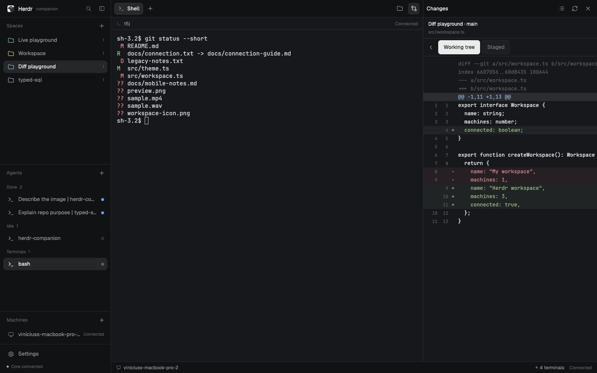
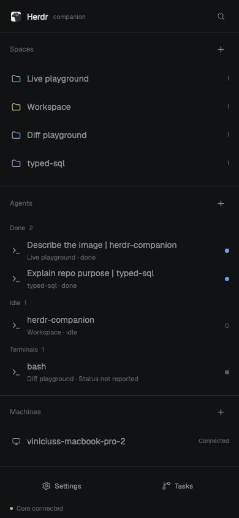
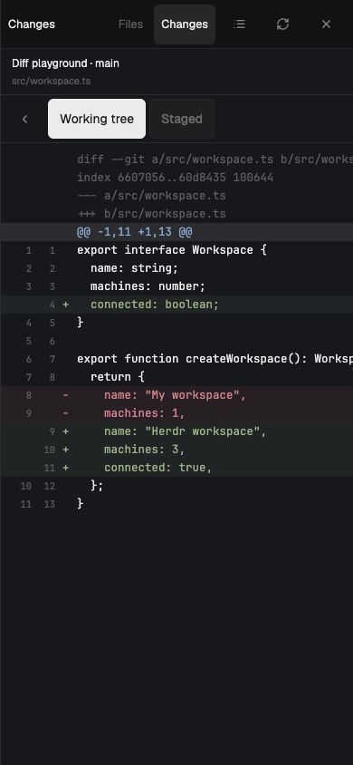
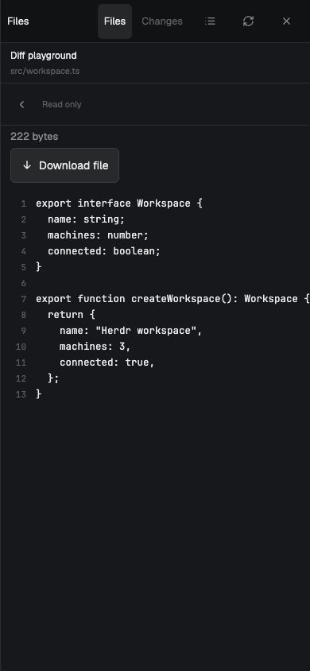
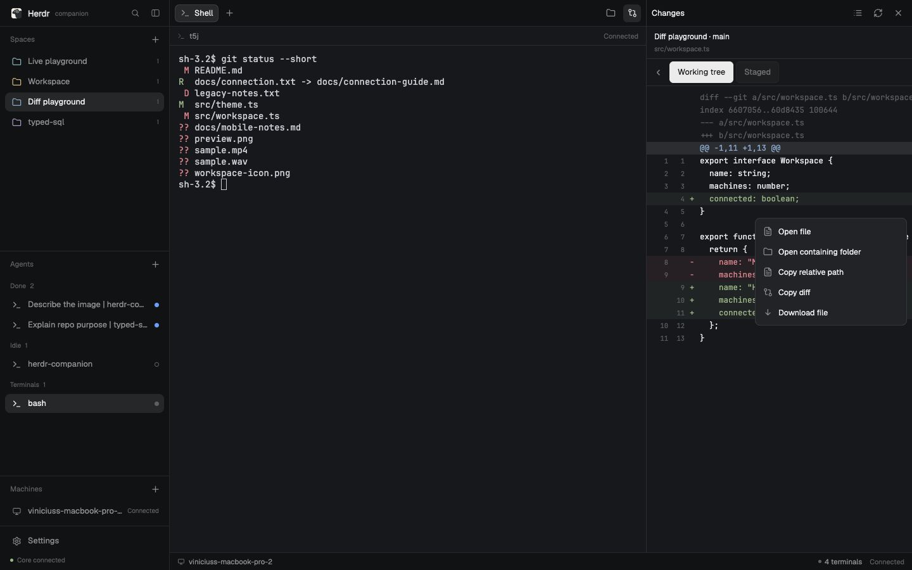
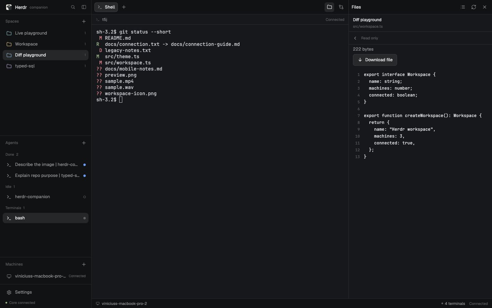
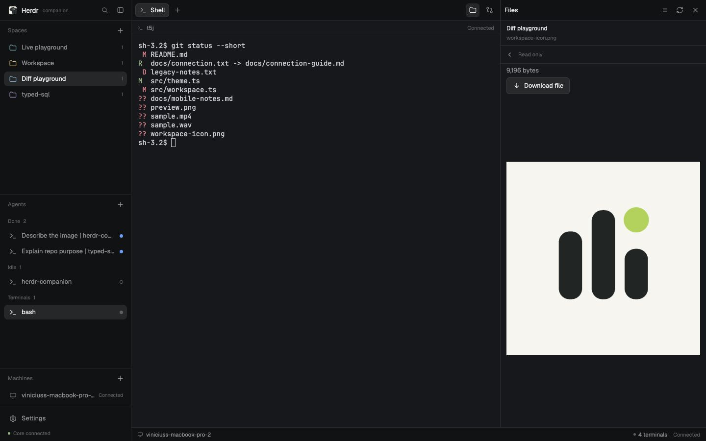
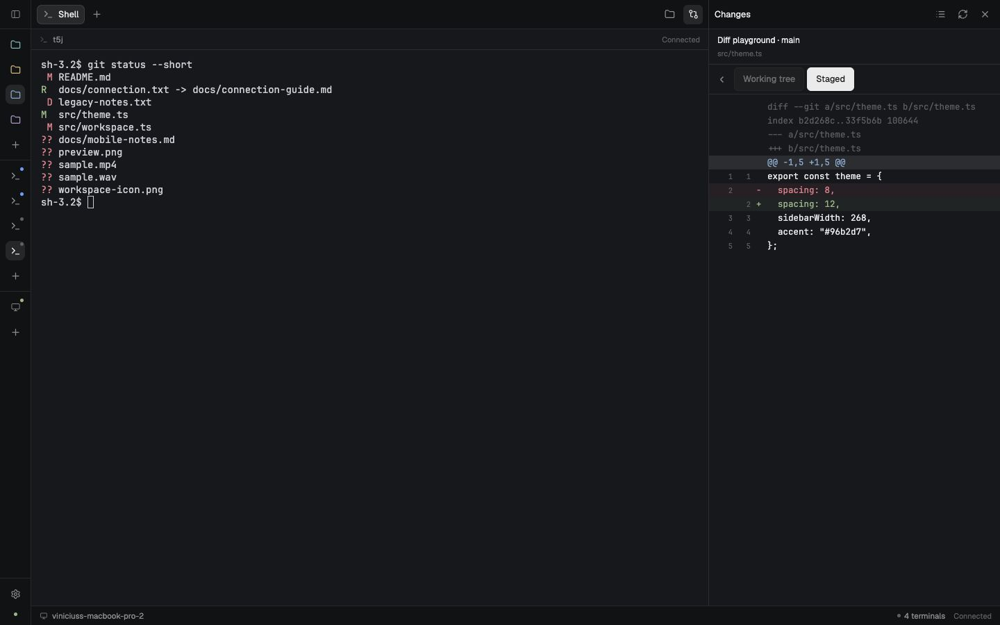

# Herdr Companion

An independent phone and browser client for new herdr-core. This repository implements the first connectivity milestone of [the build spec](herdr-companion-build-spec.md). It is an early application, not the complete P0 release.

Implemented: a Herdr-style responsive workspace with source-derived palettes/Geist typography, shared desktop spaces and new terminal/agent tabs, real core inventory and reported attention state, local approval pairing, revocation, browser cookie sessions, automatic terminal control, resizable file/diff panels, and native image input with saved custom hotkeys. The bridge stays on loopback and does not own the agents' PTYs. Task provisioning and cleanup are not enabled yet.

## Screenshots and walkthrough

[Watch or download the walkthrough (37 seconds, MP4)](https://github.com/Lojhan/herdr-companion/raw/refs/heads/main/docs/media/walkthrough.mp4)

A live web-client capture of desktop and phone layouts: terminal output, working-tree and staged diffs, file actions, source browsing, media previews, and the collapsed sidebar. No titles, captions, or added overlays.

[](https://github.com/Lojhan/herdr-companion/raw/refs/heads/main/docs/media/walkthrough.mp4)

<table>
  <tr>
    <th>Phone home</th>
    <th>Changes</th>
    <th>File preview</th>
  </tr>
  <tr>
    <td></td>
    <td></td>
    <td></td>
  </tr>
</table>

<details>
<summary>More screenshots</summary>

**Diff actions**



**Files and media**





**Collapsed sidebar**



</details>

## Run the local sandbox

Use Node 24 and pnpm 10.32.1. The native app uses Expo SDK 58 and development builds.

```sh
nvm use
pnpm install --frozen-lockfile
pnpm install:core
export COMPANION_HC="$PWD/.data/bin/hc"
pnpm dev:sandbox
```

The sandbox uses its own core session, config, state, socket, and bridge database under `.data/sandbox`. It starts without seeded workspaces or terminals. It never opens your default core session or touches a repository/worktree. In another terminal:

```sh
pnpm dev:web
```

Open http://localhost:8081. Create a pairing locally:

```sh
pnpm companion pair --endpoint http://localhost:7318 --development --data .data/sandbox/bridge
```

Paste the printed JSON into Settings, give the device a name, and choose **Pair this device**. The screen prints the claim ID; approve that exact claim locally:

```sh
pnpm companion claims --data .data/sandbox/bridge
pnpm companion approve <claim-id> --data .data/sandbox/bridge
```

Use **+** next to Spaces to choose an existing project folder, then use the tab-bar **+** to start a shell or an installed agent. Closing the page or bridge detaches viewers and leaves core programs running.

## Use an existing core

```sh
pnpm dev:bridge --hc "$HOME/.local/bin/hc" --development --origins http://localhost:8081
pnpm dev:web
pnpm companion pair --endpoint http://localhost:7318 --development
```

The normal bridge database is `~/.local/share/herdr-companion`. `--data` selects another independent installation. `--socket` selects a core endpoint; otherwise `hc connect` performs native discovery. `HC_SESSION`, `HC_SOCKET`, and XDG overrides propagate to the child process. Use the same `--data` on serve/pair/claims/approve/revoke.

For a physical phone, put the loopback bridge behind Tailscale Serve HTTPS, use that HTTPS endpoint for pairing, and run `pnpm dev:mobile` with a development build. Never use `localhost` on the phone to refer to your computer. This repository does not provision push credentials, sign native apps, publish builds, or install a background service.

The bridge currently supports one saved coordinator per app installation. Pairing is by JSON paste; QR scanning and profile switching are upcoming. Local approval defaults to owner; `approve <id> --role observer` produces a read-only credential. Remote/Windows terminal observation is available through core; control is explicitly gated until platform behavior is verified.

## Checks

```sh
pnpm check:generated
pnpm typecheck
pnpm lint
pnpm test
pnpm test:integration
pnpm exec playwright install chromium
pnpm test:e2e:web
pnpm build:bridge
pnpm build:web
pnpm run doctor
```

`test:integration` uses scratch directories and a separate core session, launches a disposable shell, verifies a real attach/input/output round trip, then stops only that test core. `test:e2e:web` starts the sandbox and Expo if ports 7318/8081 are free, pairs a browser, controls a real shell, and checks reload. It leaves the reusable sandbox core running. Do not point this acceptance fixture at a real work session.

`build:bridge` creates `apps/bridge/dist/cli.js`; run it with Node 24 from this workspace (runtime dependencies and `apps/bridge/migrations` are required). Standalone distributable packaging and service installers are not implemented.

See [implementation status](docs/IMPLEMENTATION-STATUS.md), [compatibility](docs/COMPATIBILITY.md), [validation evidence](docs/RELEASE-VALIDATION.md), and [source provenance](vendor/SOURCES.json). Pay particular attention to the pinned core's `terminal.list` schema mismatch.

The UI follows [Herdr’s default workspace](docs/DESIGN.md): a spaces/agents sidebar on desktop and tablets, separate list/detail pages on phones, and Graphite/Ink/Moss/Paper themes.

### Create and customize

Use the **+** beside Spaces to create a workspace in an existing project folder. The **+** in a workspace’s tab bar creates a shell tab or starts an installed agent command (for example, `codex`). The Agents list also has a **+**. These append to the owning core’s `herdr-app` document with compare-and-swap; existing layout fields and concurrent desktop tabs are preserved. Authorized local terminals are controllable immediately. Browser input goes directly to xterm; the composer, images and hotkeys are native-app controls. Failed or uncertain launches are never retried automatically.

The Machines **+** is available to owners and adds an SSH target using the coordinator’s existing SSH setup. Configure remote `hc`, keys and known hosts first. Controllers can create workspaces and terminal/agent tabs; observers cannot create resources. Remote terminal control remains disabled.

In the native app, use the pinned **+** on the terminal hotkey bar to add, edit or remove up to 12 shortcuts. Examples: `Alt+Enter`, `Ctrl+Shift+Left`, or `Ctrl+B, %`. Hotkeys persist across native app restarts. Saving a key never sends it to a terminal.

### Files and changes

**Files** browses the active workspace folder and previews text with line numbers, images, audio, video and PDFs when supported by the device. Media previews are bounded to 20 MB; the download action streams the original file and opens the native save/share sheet on mobile. **Changes** reads real Git status and unified diffs, including working-tree, staged, deleted, renamed and untracked files. Right-click a diff (long-press on mobile), or use File actions, to open it in Files, reveal its containing folder, copy its path/diff, or download it. Binary and oversized files receive explicit notices. These panels are read-only and currently support folders on the coordinator machine; remote file browsing is not implemented. Reads are limited to the configured workspace root and cannot traverse links outside it or expose `.git` internals.

Drag either panel divider to resize it. Pull past the minimum width to close the inspector or collapse navigation into its rail; double-click a divider to reset it. Keyboard arrow keys resize a focused divider. Widths are remembered in browser session storage. The core connection indicator keeps the same fixed bottom offset in both navigation states. The DEV overlay and its runtime sample inventories have been removed.

### Test on a real phone over Wi-Fi

Run `pnpm exec tsx scripts/dev-sandbox.ts --lan` and `pnpm --filter @companion/mobile exec expo start --go --lan --port 8081`. Use the LAN address printed by Expo in Expo Go, and pair using the same computer's LAN address on port 7318. SDK 58 Expo Go may require signing into the same Expo account in the CLI and on the phone. Pairing approval remains required. The development bridge accepts only private-network/loopback clients in this mode; normal serving remains loopback-only. Production coordinators require HTTPS.
